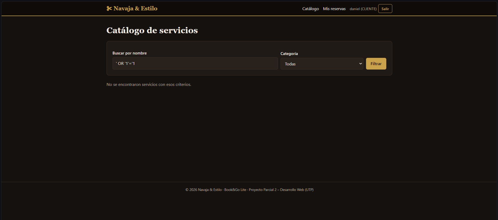
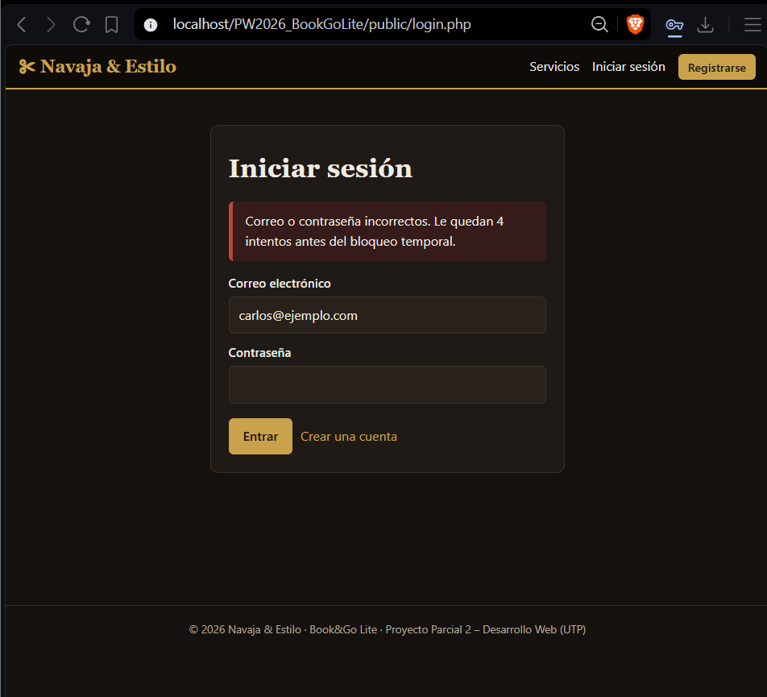
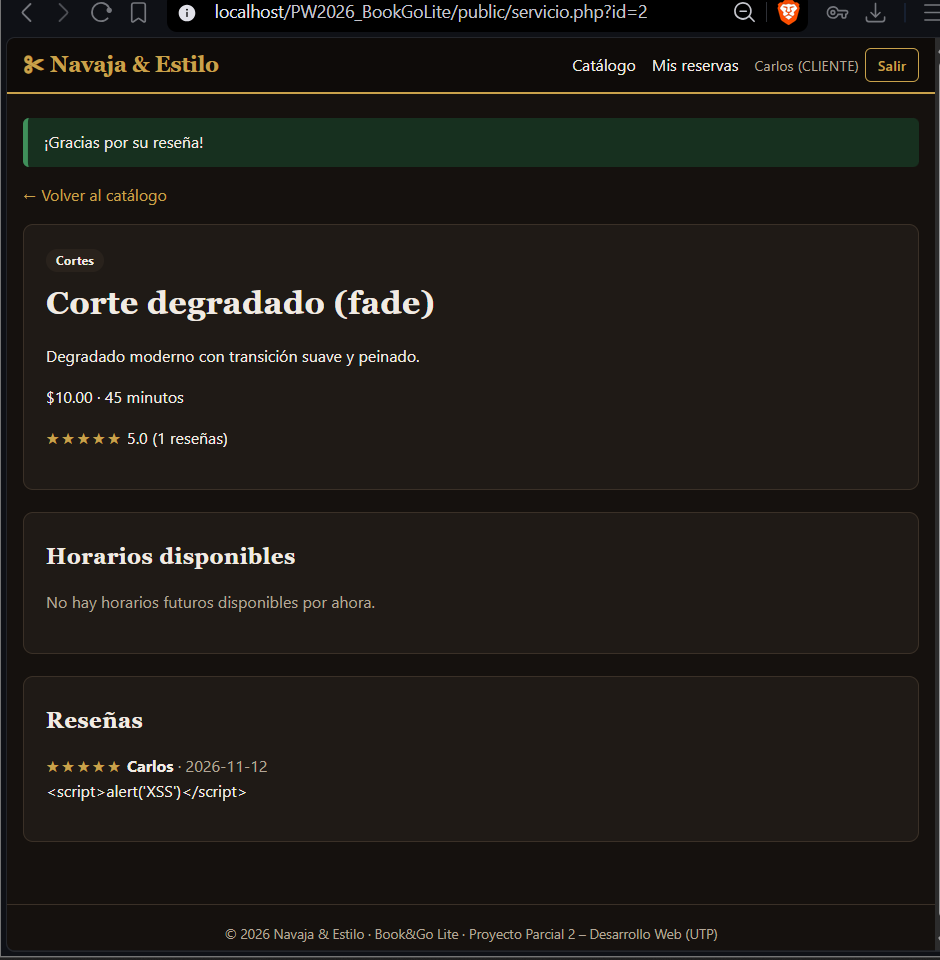
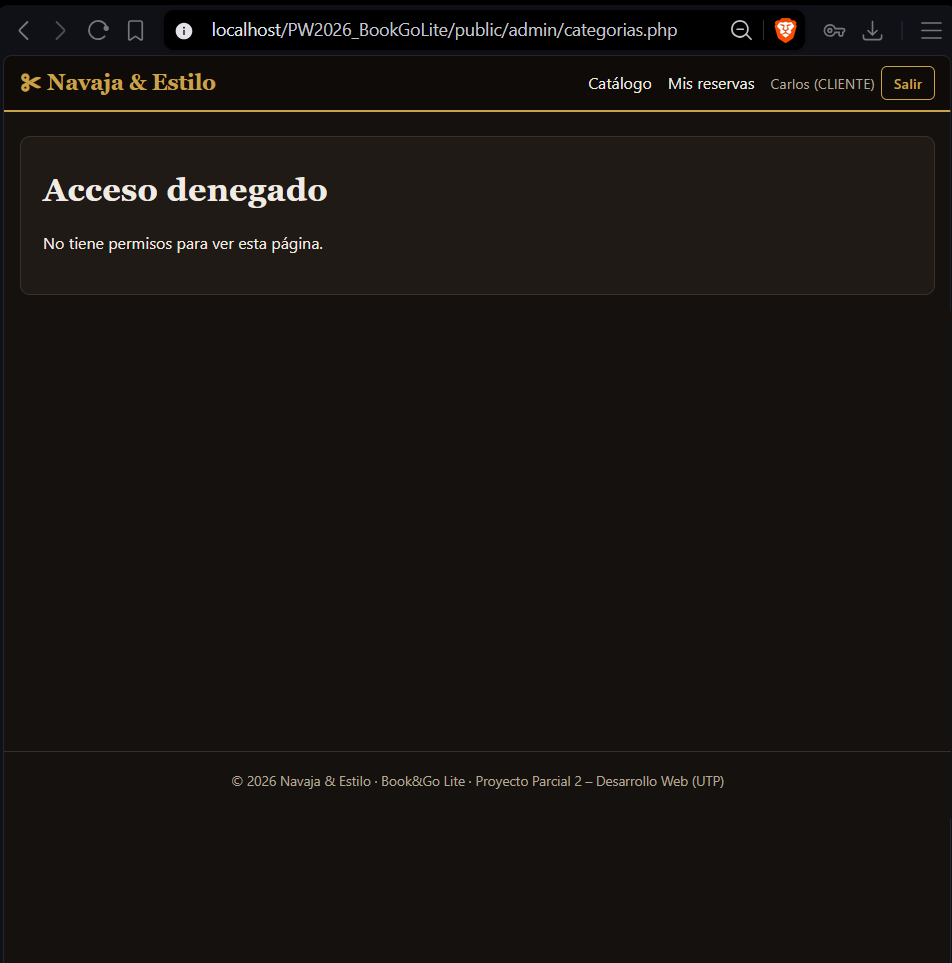
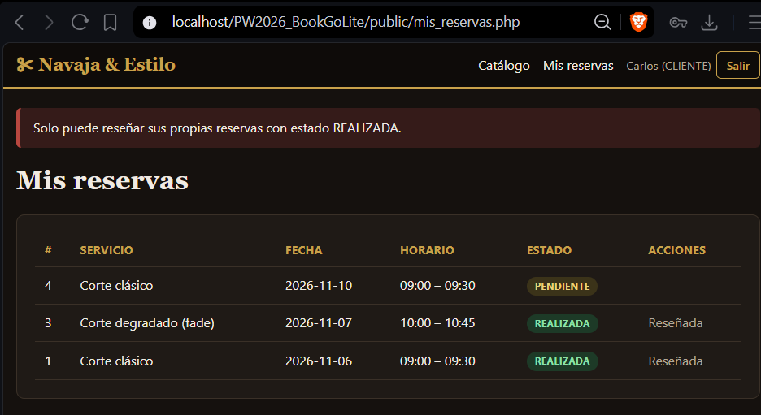
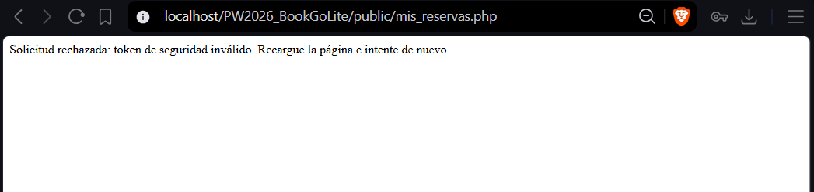
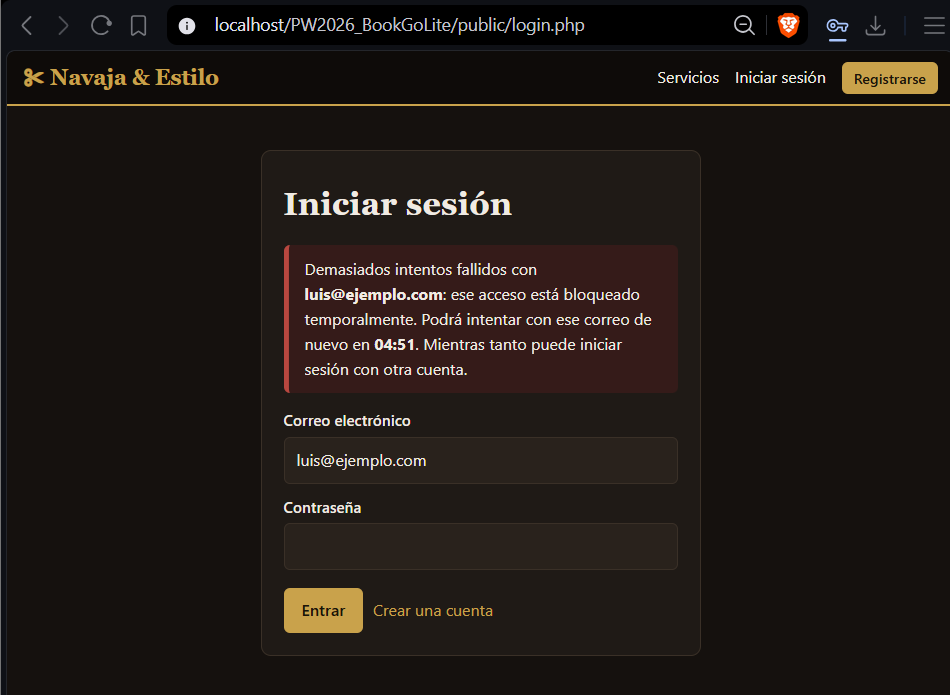
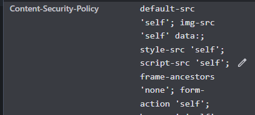

# Seguridad web – Book&Go Lite (Navaja & Estilo)

Documento de controles de ciberseguridad y pruebas realizadas (sección 7 del Proyecto Parcial 2).
Todas las pruebas se ejecutaron **únicamente en nuestra aplicación de desarrollo** (`http://localhost/PW2026_BookGoLite/public/`, XAMPP: Apache + MariaDB, PHP 8.2).

Usuarios de prueba: clientes `carlos@ejemplo.com`, `luis@ejemplo.com`, `andres@ejemplo.com` (contraseña de prueba `Cliente123!`) y un ADMIN creado con `database/create_admin.php`.
Las capturas están en la carpeta [`evidencias/`](evidencias/).

## 1. Resumen

| # | Prueba | Control aplicado | Resultado |
|---|---|---|---|
| 1 | SQL Injection en búsqueda y login | PDO + consultas preparadas | La entrada no altera la consulta |
| 2 | XSS en comentario de reseña | `htmlspecialchars` (ENT_QUOTES, UTF-8) + CSP | El script se muestra como texto |
| 3 | CLIENTE entra directo a página ADMIN | Validación de rol en PHP | Acceso denegado (HTTP 403) |
| 4 | Acceso a reserva de otro cliente | Filtro por dueño en SQL | No se muestra ni se modifica |
| 5 | Formulario sin token CSRF válido | Token por sesión verificado en cada POST | Operación rechazada, sin cambios |
| 6 | Cinco intentos de login fallidos | Bloqueo temporal de 5 min por correo | Bloqueo con cuenta regresiva |
| 7 | Inspección de cabeceras HTTP | CSP, X-Content-Type-Options, X-Frame-Options | Cabeceras presentes |

---

## Prueba 1 – SQL Injection (búsqueda y login)

**Objetivo.** Comprobar que una entrada maliciosa no cambia la consulta SQL ni permite saltarse la autenticación.

**Pasos.**
1. En el catálogo (`/catalogo.php`) escribir en "Buscar por nombre": `' OR '1'='1` y pulsar *Filtrar*.
2. Repetir con `' UNION SELECT 1,2,3,4,5,6-- -`.
3. En `/login.php` escribir el correo `carlos@ejemplo.com` y como contraseña `' OR '1'='1`.

**Resultado observado.**
- Búsqueda normal ("barba"): 1 servicio. Con `' OR '1'='1`: **0 servicios** y el mensaje "No se encontraron servicios con esos criterios". Con `UNION SELECT`: 0 servicios. Si la inyección funcionara, saldrían todos los servicios.
- Login con el payload en la contraseña: **no inicia sesión** (la página vuelve al formulario con "Correo o contraseña incorrectos").

**Control aplicado.** Todas las consultas usan **PDO con consultas preparadas** y parámetros enlazados; los valores del usuario nunca se concatenan en el SQL (`public/catalogo.php`, `public/login.php`, `public/registro.php`, `includes/reservas.php`, paneles ADMIN). El modo de emulación de PDO está desactivado (`ATTR_EMULATE_PREPARES => false` en `includes/bootstrap.php`), por lo que las sentencias se preparan realmente en el servidor.

**Evidencia.** `evidencias/01a_sqli_busqueda.png`, `evidencias/01b_sqli_login.png`




---

## Prueba 2 – XSS en un campo visible (comentario de reseña)

**Objetivo.** Verificar que un script ingresado por un usuario se muestra como texto y no se ejecuta.

**Pasos.**
1. Iniciar sesión como `carlos@ejemplo.com`.
2. En *Mis reservas*, en la reserva REALIZADA de "Corte degradado (fade)", pulsar *Reseñar*.
3. Calificación 5 y comentario: `<script>alert('XSS')</script>`. Pulsar *Publicar reseña*.
4. Se abre el detalle del servicio, donde se listan las reseñas.

**Resultado observado.** No aparece ninguna ventana de alerta. El comentario se ve literalmente como `<script>alert('XSS')</script>`. En la base de datos el texto se guarda tal cual, y el HTML devuelto contiene `&lt;script&gt;alert(&#039;XSS&#039;)&lt;/script&gt;` (sin ninguna etiqueta `<script>` real).

**Control aplicado.** Salida codificada con la función `e()` = `htmlspecialchars($v, ENT_QUOTES | ENT_SUBSTITUTE, 'UTF-8')` en todas las vistas (`includes/bootstrap.php`). Además, la validación de entrada limita longitud y tipo (calificación entera 1–5, comentario 3–500 caracteres en `public/resenar.php`) y la **Content-Security-Policy** (`script-src 'self'`) impide ejecutar scripts en línea aunque llegara a colarse uno.

**Evidencia.** `evidencias/02_xss_resena.png`



---

## Prueba 3 – Acceso directo de un CLIENTE a una página ADMIN

**Objetivo.** Comprobar que la restricción por rol se valida en PHP, no solo ocultando el menú.

**Pasos.**
1. Iniciar sesión como `carlos@ejemplo.com` (CLIENTE). El menú no muestra opciones de administración.
2. Escribir directamente en la barra de direcciones: `http://localhost/PW2026_BookGoLite/public/admin/categorias.php`.
3. Repetir con `admin/servicios.php`, `admin/horarios.php`, `admin/reservas.php` y `admin/index.php`.

**Resultado observado.** Las 5 páginas responden **HTTP 403** con el mensaje "Acceso denegado. No tiene permisos para ver esta página.". Sin ninguna sesión, las mismas URL redirigen (302) a `login.php`.

**Control aplicado.** Cada página de administración empieza con `requiere_rol('ADMIN')` (`includes/bootstrap.php`), que valida en el servidor el usuario de la sesión, su estado ACTIVO y su rol consultando la base de datos en cada petición.

**Evidencia.** `evidencias/03_acceso_admin_denegado.png` (debe verse la URL en la barra)



---

## Prueba 4 – Acceso a la reserva de otro cliente

**Objetivo.** Comprobar que un cliente solo puede ver o modificar sus propias reservas y reseñas.

**Pasos.**
1. Iniciar sesión como `carlos@ejemplo.com`. En *Mis reservas* solo aparecen sus 3 reservas.
2. La reserva n.º 2 pertenece a Luis. Escribir en la barra: `http://localhost/PW2026_BookGoLite/public/resenar.php?reserva=2`.

**Resultado observado.** Se redirige a *Mis reservas* con el mensaje "Solo puede reseñar sus propias reservas con estado REALIZADA.". También se intentó cancelar la reserva 5 (de Luis) enviando la petición como Carlos: respuesta "Reserva no encontrada." y la reserva siguió en estado **CONFIRMADA**.

**Control aplicado.** Las consultas incluyen siempre el id del usuario de la **sesión**, nunca uno recibido del navegador: `WHERE r.cliente_id = :cid` (`public/mis_reservas.php`), `r.id = :id AND r.cliente_id = :c AND r.estado = 'REALIZADA'` (`public/resenar.php`) y el filtro de propiedad dentro de la transacción de cancelación (`includes/reservas.php`).

**Evidencia.** `evidencias/04_reserva_ajena.png`



---

## Prueba 5 – Formulario sin token CSRF válido

**Objetivo.** Verificar que una operación que cambia datos se rechaza si el token CSRF falta o es falso.

**Pasos.**
1. Iniciar sesión como `carlos@ejemplo.com`, abrir un servicio con horarios futuros (por ejemplo "Tratamiento capilar") y pulsar *Reservar*. Luego ir a *Mis reservas*: la nueva reserva queda PENDIENTE y muestra el botón *Cancelar* (solo se puede cancelar una cita que aún no comenzó).
2. Abrir las herramientas del navegador (F12) → *Elements*, localizar el campo oculto `<input type="hidden" name="csrf" value="...">` del formulario del botón *Cancelar*.
3. Cambiar su valor por `abc123` (o eliminar el campo) y pulsar *Cancelar*.

**Resultado observado.** Aparece "Solicitud rechazada: token de seguridad inválido. Recargue la página e intente de nuevo." con **HTTP 403**, tanto sin token como con token falso. La reserva sigue en estado **PENDIENTE** (no cambió ningún dato).

**Control aplicado.** Token aleatorio de 32 bytes por sesión (`random_bytes`), incluido con `csrf_field()` en cada formulario POST y verificado con `hash_equals` mediante `csrf_check()` al inicio de cada operación que modifica datos: registro, login, logout, reservas, cancelaciones, reseñas y todas las operaciones del panel ADMIN, incluidos los cambios de estado. Se regenera al iniciar sesión. La cookie de sesión además usa `SameSite=Lax`.

**Evidencia.** `evidencias/05_csrf_rechazado.png`



---

## Prueba 6 – Cinco intentos de login fallidos

**Objetivo.** Comprobar el bloqueo temporal tras cinco intentos fallidos, sin revelar si el correo existe.

**Pasos.**
1. En `/login.php` intentar entrar 5 veces con `luis@ejemplo.com` y contraseñas incorrectas.
2. Observar los avisos de intentos restantes y, tras el quinto, el bloqueo.
3. Intentar con la contraseña correcta mientras dura el bloqueo.
4. En el mismo navegador, iniciar sesión con otra cuenta.

**Resultado observado.** Los intentos 1 a 4 muestran "Le quedan N intentos antes del bloqueo temporal". En el quinto aparece "Demasiados intentos fallidos con luis@ejemplo.com: ese acceso está bloqueado temporalmente. Podrá intentar con ese correo de nuevo en **05:00**", con cuenta regresiva en vivo. Durante el bloqueo **ni la contraseña correcta entra**, incluso desde otro navegador. Otra cuenta sí puede iniciar sesión con normalidad. Al vencer el tiempo, el acceso correcto funciona. Un correo que **no existe** muestra exactamente el mismo comportamiento, por lo que no se puede deducir qué correos están registrados.

**Control aplicado.** Contador de intentos y `bloqueado_hasta` por usuario en la base de datos, más un contador por sesión que aplica a cualquier correo (`MAX_INTENTOS = 5`, `BLOQUEO_MIN = 5` en `public/login.php`). El tiempo restante se calcula en SQL para no depender de la zona horaria de PHP. Se ejecuta `password_verify` también con un hash falso cuando el correo no existe, para igualar los tiempos de respuesta.

**Evidencia.** `evidencias/06_bloqueo_login.png`



---

## Prueba 7 – Inspección de cabeceras HTTP

**Objetivo.** Verificar que el servidor envía las cabeceras de seguridad configuradas.

**Pasos.**
1. Abrir `http://localhost/PW2026_BookGoLite/public/login.php`.
2. F12 → pestaña *Network* (Red) → recargar la página (Ctrl+R).
3. Pulsar la petición `login.php` → *Headers* → sección *Response Headers*.

**Resultado observado.**
```
Content-Security-Policy: default-src 'self'; img-src 'self' data:; style-src 'self'; script-src 'self'; frame-ancestors 'none'; form-action 'self'; base-uri 'self'
X-Content-Type-Options: nosniff
X-Frame-Options: DENY
Referrer-Policy: same-origin
Set-Cookie: BOOKGOSESS=...; path=/; HttpOnly; SameSite=Lax
```

**Control aplicado.** Las cabeceras se envían desde `includes/bootstrap.php` en todas las páginas. La CSP impide cargar recursos de otros orígenes y scripts en línea; `X-Frame-Options: DENY` junto con `frame-ancestors 'none'` evita el *clickjacking*; `nosniff` evita que el navegador adivine tipos de archivo.

**Evidencia.** `evidencias/07a_cabecera_csp.png` y `evidencias/07b_cabeceras_nosniff_frame.png`




---

## Otros controles implementados

| Control | Cómo | Dónde |
|---|---|---|
| Contraseñas | `password_hash()` / `password_verify()`; nunca texto plano. Política: 8+ caracteres con mayúscula, minúscula, número y carácter especial | `includes/password_policy.php`, `public/registro.php`, `public/login.php` |
| Sesiones | `session_regenerate_id(true)` al iniciar sesión; sesión destruida y cookie borrada al salir; cookie `HttpOnly`, `SameSite=Lax` y `Secure` cuando hay HTTPS; `use_strict_mode` | `includes/bootstrap.php`, `public/login.php`, `public/logout.php` |
| Logout | Solo por POST con token CSRF | `public/logout.php` |
| Registro público | Solo crea CLIENTE (rol fijado en el servidor). El ADMIN se crea por consola, sin contraseña en el repositorio | `public/registro.php`, `database/create_admin.php` |
| Errores | Mensajes genéricos al usuario; el detalle va al log del servidor (`display_errors` desactivado) | `includes/bootstrap.php` |
| Integridad de datos | Claves foráneas, `CHECK` (precio, duración, horas, cupos), clave compuesta horario–servicio, `UNIQUE` de reserva activa por horario | `database/schema.sql` |
| Reservas | Transacción con `FOR UPDATE` y `UPDATE ... WHERE cupos_disponibles > 0`; la cancelación devuelve exactamente un cupo | `includes/reservas.php` |

## Limitaciones conocidas
- En local se usa HTTP; el atributo `Secure` de la cookie se activa automáticamente al servir la aplicación por HTTPS.
- El contador de intentos por sesión puede reiniciarse borrando cookies, pero el bloqueo por cuenta en la base de datos se mantiene.
